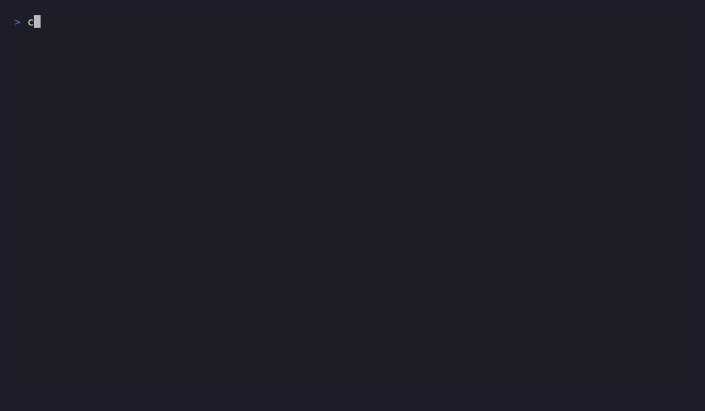
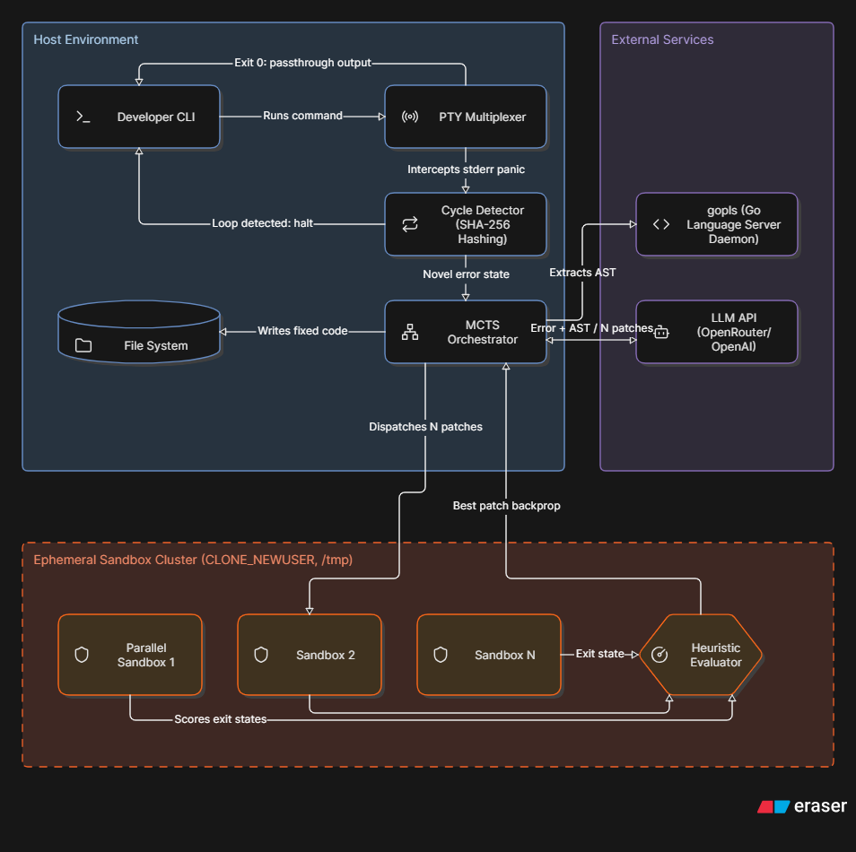

<div align="center">

# heal-cli

**A transparent execution proxy that catches Go runtime failures and repairs the source automatically.**

[](https://github.com/sainathmanda7/heal-cli/actions)
[](https://go.dev)
[](#prerequisites)
[](LICENSE)
[](https://github.com/sainathmanda7/heal-cli/releases)
[](#contributing)

[Demo](#demo) · [Features](#features) · [Architecture](#architecture) · [Getting Started](#getting-started) · [Roadmap](#roadmap) · [Contributing](#contributing)

</div>

---

## Overview

`heal-cli` is a developer proxy written in Go that wraps command-line workflows, catches crashes, and searches for verified patches using Monte Carlo Tree Search (MCTS) without touching your source files until a patch is proven safe.

Rather than blindly trusting raw model output:
- Context is extracted semantically via `gopls` (structs, interfaces, and signatures), not ad-hoc regex.
- Fixes are simulated inside isolated Linux user namespaces on an ephemeral `/tmp` copy before touching host files.
- Multiple candidates are evaluated concurrently and scored by blast radius and execution outcome.
- Stack traces are hashed without dynamic pointer addresses to identify repeated error loops and halt quickly.

If your process succeeds, `heal` remains completely transparent. If it fails, `heal` isolates the crash and repairs it.

## Demo

<p align="center">
  
</p>

```bash
$ heal go run main.go
# Process runs normally. If it crashes, heal intercepts and tests candidate patches.
```

## Features

- **Transparent PTY proxy:** Wraps commands through a pseudo-terminal so ANSI colors, real-time streaming, interactive `stdin`, and terminal resize events (`SIGWINCH`) work out of the box.
- **AST and type context via `gopls`:** Queries a headless language server for accurate struct definitions, interfaces, and signatures surrounding the failure site.
- **Parallel patch exploration:** Evaluates candidate fixes concurrently in goroutines rather than a fragile linear retry loop.
- **Rootless Linux sandboxing:** Runs test patches inside ephemeral namespaces (`CLONE_NEWUSER`) in `/tmp`, preventing untested code from modifying your project or host system.
- **Loop and cycle prevention:** Hashes normalized stack traces to catch recurring failures and stop before wasting API credits.
- **Execution bounds:** Enforces timeouts across both initial command runs and sandboxed candidates to prevent hangs, deadlocks, and runaway resource usage.
- **OpenAI-compatible:** Compatible with OpenAI, OpenRouter, local Ollama gateways, or any endpoint adhering to the `/v1/chat/completions` schema.

## Architecture

<p align="center">
  
</p>

| # | Stage | Mechanism | Purpose |
|---|-------|-----------|---------|
| 1 | **Interception** | Allocates a PTY multiplexing stdout/stderr, handling `SIGWINCH` and interactive `stdin`. | Keeps terminal behavior intact and stays invisible on success. |
| 2 | **Context Extraction** | Queries `gopls` over JSON-RPC for types, interfaces, and function signatures. | Supplies concrete AST context to help the model identify root causes. |
| 3 | **Parallel Search** | Generates candidate variants and evaluates them concurrently. | Explores multiple solution paths and selects the highest scoring patch. |
| 4 | **Sandboxing** | Re-exec pattern using unprivileged `CLONE_NEWUSER` against `/tmp`. | Validates candidate patches in isolation before writing back to source code. |
| 5 | **Cycle Detection** | SHA-256 fingerprint of pointer-normalized execution stack traces. | Detects circular error loops early and terminates the search. |

### Design Decisions

- **Why Go?** Native concurrency via goroutines, built-in cancellation via `context`, straightforward access to Linux system calls, and single static binary distribution.
- **Why a PTY instead of standard pipes?** Many CLI tools change behavior without a TTY. A pseudo-terminal ensures native output formatting and interactivity remain intact.
- **Why `gopls`?** Official language server providing accurate structural types and definitions directly from Go's AST.
- **Why namespaces over Docker?** Ephemeral namespaces start in milliseconds with zero runtime dependencies or daemon overhead.
- **Why hash normalized stack traces?** Pointer addresses change across runs, but normalized frames remain consistent, enabling cheap and reliable cycle detection without extra model calls.

## Security & Sandboxing

Candidate patches execute machine-generated code and must be safely bounded:

| Threat | Behavior | Mitigation |
|--------|----------|------------|
| **Infinite loops / Deadlocks** | Process hangs indefinitely | Host and sandbox execution are governed by `context.WithTimeout`. Hung processes are killed and flagged as unhandled errors. |
| **Destructive filesystem calls** | Patch calls commands like `os.RemoveAll` | Verification runs in an isolated user namespace in `/tmp`. Any destruction is confined to throwaway scratch space. |
| **Memory leaks / Out-of-memory** | Patch allocates uncontrollably | Abnormal OS process termination is intercepted and penalized by the state evaluator. |

## Getting Started

### Prerequisites

- **Linux or WSL** (relies on Linux user namespaces)
- **Go 1.22+**
- **gopls**
- API key for any OpenAI-compatible provider

### Installation

```bash
# 1. Install heal-cli
go install github.com/sainathmanda7/heal-cli@latest

# 2. Install the gopls language server
go install golang.org/x/tools/gopls@latest
```

### Configuration

Add your API credentials to your shell configuration (`~/.bashrc` or `~/.zshrc`):

```bash
export OPENAI_API_KEY="your-api-key"
export OPENAI_BASE_URL="https://openrouter.ai/api/v1"
```

| Variable | Required | Description |
|----------|----------|-------------|
| `OPENAI_API_KEY` | Yes | API key for your LLM provider. |
| `OPENAI_BASE_URL` | Yes | Base URL for any OpenAI-compatible API endpoint. |

### Usage

Prepend `heal` to your build or run command:

```bash
heal go run main.go
```

- **Exit 0:** Passes output through normally and exits silently.
- **Crash or Panic:** Intercepts stderr, extracts AST context via `gopls`, runs candidate search in isolated namespaces, and applies the verified fix.
- **Loop Detected:** Halts immediately if the same error fingerprint recurs.

## Roadmap

- [x] PTY-based transparent proxy with `SIGWINCH` and stdin handling
- [x] Headless `gopls` context extraction over JSON-RPC
- [x] Parallel MCTS candidate search with blast-radius scoring
- [x] Namespace sandbox via re-exec and `CLONE_NEWUSER`
- [x] SHA-256 stack-trace cycle detection
- [ ] CLI flags and configuration file for candidate counts, timeouts, and search depth
- [ ] Interactive confirmation mode to inspect diffs prior to disk write
- [ ] Additional sandbox confinement (`seccomp` filters and cgroup resource limits)
- [ ] Support for additional languages and language servers
- [ ] macOS support via platform-native isolation backends
- [ ] Local model support via embedded llama.cpp / Ollama defaults

## Contributing

1. Fork the repository and create a feature branch: `git checkout -b feat/my-feature`
2. Ensure tests and formatting pass:
   ```bash
   gofmt -l .
   go vet ./...
   go test ./...
   ```
3. Open a pull request detailing the changes and relevant context.

## License

Distributed under the [MIT License](LICENSE).
