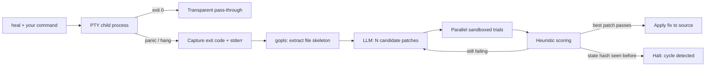

<div align="center">

# heal-cli

**A transparent execution proxy that catches Go runtime failures and repairs the source automatically, treating the LLM as an unreliable sub-routine, not an oracle.**

[](https://github.com/yourusername/heal-cli/actions)
[](https://go.dev)
[](#prerequisites)
[](LICENSE)
[](https://github.com/yourusername/heal-cli/releases)
[](#contributing)

[Demo](#demo) · [Features](#key-features) · [Architecture](#architecture) · [Getting Started](#getting-started) · [Roadmap](#roadmap) · [Contributing](#contributing)

</div>

---

## Overview

`heal-cli` is a fault-tolerant, OS-level execution proxy written natively in Go. It wraps your normal developer commands, intercepts critical runtime failures, and runs a **Monte Carlo Tree Search (MCTS)** over candidate patches to repair your code without human intervention.

Most "AI fixers" paste model output straight into your repo and hope for the best. `heal-cli` takes the opposite stance: **the LLM is an untrusted, non-deterministic component** and must be constrained by structure and isolation:

- **Structurally**, by grounding prompts in real language-server data rather than raw error strings.
- **Physically**, by running every candidate patch inside a Linux kernel namespace on a throwaway copy of your code.
- **Statistically**, by searching across multiple candidates and scoring them, never trusting a single linear retry.
- **Economically**, by hashing execution state to detect hallucination loops before they burn your API budget.

If your command succeeds, `heal` stays invisible. If it crashes, `heal` takes over.

## Demo

<p align="center">
  
</p>

```bash
$ heal go run main.go
# ... your program runs exactly as it normally would ...
# ... on a crash, heal captures the failure and starts the repair search ...
```

## Key Features

- **🖥️ Zero-friction wrapper:** Prepend `heal` to any command. Your terminal behaves identically on success: real-time output, window resizing, and interactive stdin all work.
- **🧠 Semantic, not string-based, context:** A headless `gopls` daemon supplies structs, interfaces, and function signatures so the model fixes the **root cause**, not the downstream symptom.
- **🌳 Parallel MCTS repair search:** N diverse candidate patches are generated and tested concurrently in goroutines, then scored by a blast-radius heuristic.
- **🛡️ Kernel-namespace sandboxing:** Candidates run via the re-exec pattern with `CLONE_NEWUSER` against an ephemeral `/tmp` workspace. There's no container runtime or VM boot to wait for.
- **🔁 Cryptographic cycle detection:** A SHA-256 hash of the normalized, pointer-stripped stack trace identifies repeated failure states and halts the search immediately.
- **⚖️ Graceful-degradation scoring:** The evaluator understands that replacing a raw `panic()` with a logged `os.Exit(1)` is a better outcome than a crash, and ranks it accordingly.
- **⏱️ Hard execution limits:** Host and sandbox executions are wrapped in `context.WithTimeout`, so deadlocks and runaway processes are killed and converted into repairable failures.
- **🔌 Provider-agnostic:** Works with any OpenAI-compatible endpoint (OpenAI, OpenRouter, self-hosted gateways) via `OPENAI_BASE_URL`.

## Architecture

`heal-cli` is a five-stage pipeline. Each stage exists to remove a specific class of failure common to LLM-driven repair tools.



| # | Stage | Mechanism | Why it exists |
|---|-------|-----------|---------------|
| 1 | **Transparent interception** | Allocates a pseudo-terminal (PTY) and multiplexes stdout/stderr to the host in real time; handles `SIGWINCH` and interactive stdin. | Plain pipes strip TTY behavior (colors, prompts, resizing). A PTY keeps your environment intact and keeps the proxy invisible on success. |
| 2 | **Semantic context extraction** | Queries `gopls` as a background daemon over JSON-RPC to retrieve structs, interfaces, and function signatures. | String-parsing broken code is brittle. Structural context steers the model toward upstream root causes. |
| 3 | **Parallel state-space search** | **Expansion:** N diverse candidate patches. **Simulation:** N concurrent goroutines. **Backpropagation:** blast-radius scoring promotes the best branch. | Linear retry loops explore one idea at a time. A search tree explores several and keeps the strongest. |
| 4 | **Kernel sandboxing** | Re-exec pattern with `CLONE_NEWUSER`; target file is cloned into an ephemeral `/tmp` workspace for every trial. | Docker-class isolation is too heavy for an inner loop. Namespaces start fast and keep untrusted patches away from your source tree. |
| 5 | **Cycle detection** | SHA-256 over the normalized, pointer-stripped execution stack trace, stored as an append-only state history. | Models loop (Fix A causes Error B, which causes Error A). A repeated hash proves thrashing and stops spend. |

### Design Decisions

- **Why Go?** Goroutines make parallel candidate evaluation cheap, `context` gives first-class cancellation and timeouts, and direct access to Linux syscalls makes namespace work straightforward. The tool ships as a single static binary.
- **Why a PTY instead of pipes?** Developer tools behave differently when they detect a terminal. A PTY preserves that behavior so wrapping a command doesn't change it.
- **Why `gopls`?** It is the official Go language server, so signatures and types come from the same source of truth your editor uses, not from regex over source text.
- **Why namespaces instead of Docker?** The sandbox sits in the hot path of every candidate trial. Namespaces avoid image management and daemon dependencies, and keep per-trial overhead minimal.
- **Why hash stack traces?** Stack traces are a stable fingerprint of program state at failure. Stripping pointers and normalizing the trace makes equivalent failures collide, so a loop is detected by a cheap comparison instead of another LLM call.

## Security & Adversarial Hardening

`heal-cli` executes machine-generated code by design, so safety is a first-class concern. The engine has been exercised against the following adversarial payload classes:

| Threat | Behavior | Mitigation |
|--------|----------|------------|
| **Fork bombs / CPU exhaustion** | Process deadlocks or spawns infinitely | Host and sandbox execution are wrapped in `context.WithTimeout`. The process is killed and a synthetic timeout trace is injected, which feeds back into the repair loop. |
| **Host wipers / filesystem escape** | Patch calls destructive commands such as `os.RemoveAll` | Code runs in an isolated namespace against an ephemeral `/tmp` copy. Destruction is confined to the throwaway workspace; the host repository is left untouched. |
| **Memory leaks / OOM** | Patch allocates unboundedly | Standard OS process termination is mapped back to the heuristic evaluator as an *Unhandled Panic*. |

> **Note:** Sandboxing is defense-in-depth, not a substitute for good hygiene. Treat `heal` as you would any tool that executes generated code: review applied diffs (use version control), and prefer disposable environments when working with code you don't trust.

## Getting Started

### Prerequisites

- **Linux or WSL.** The sandbox relies on Linux syscalls and unprivileged user namespaces.
- **Go** (1.22+ recommended)
- **gopls** (installed below)
- An API key for an **OpenAI-compatible** endpoint

### Installation

```bash
# 1. Install heal-cli
go install github.com/yourusername/heal-cli@latest

# 2. Install the language-server dependency
go install golang.org/x/tools/gopls@latest
```

<!-- Update the module path above to your real repository before publishing. -->

### Configuration

Export your credentials in `~/.bashrc` or `~/.zshrc`:

```bash
export OPENAI_API_KEY="your-api-key"
export OPENAI_BASE_URL="https://openrouter.ai/api/v1"
```

| Variable | Required | Description |
|----------|----------|-------------|
| `OPENAI_API_KEY` | ✅ | API key for your LLM provider. |
| `OPENAI_BASE_URL` | ✅ | Base URL of any OpenAI-compatible API (e.g. OpenRouter, OpenAI, or a self-hosted gateway). |

### Verify the install

```bash
heal go run main.go
```

If the program succeeds, you'll see exactly the output you'd see without `heal`.

## Usage

Prepend `heal` to any standard execution command:

```bash
heal go run main.go
```

**What happens next:**

| Outcome | `heal` behavior |
|---------|-----------------|
| Command exits `0` | Stays completely invisible. Output is passed through untouched. |
| Command panics, crashes, or hangs | Captures the exit code and stderr, extracts context via `gopls`, and starts the repair search. |
| A candidate patch passes | The highest-scoring fix is promoted and applied. |
| A failure state repeats | Cycle detection halts the search and stops further API spend. |

### Example: graceful degradation

Given a program that crashes with a raw `panic()` on bad input, `heal` may promote a patch that logs the error and exits with a non-zero status. A deliberate, observable failure beats an unrecoverable crash, and the scoring heuristic reflects that.

## Roadmap

> Items marked ✅ are part of the current design; the rest are proposed directions, not commitments.

- [x] PTY-based transparent proxy with `SIGWINCH` and stdin handling
- [x] Headless `gopls` context extraction over JSON-RPC
- [x] Parallel MCTS candidate search with blast-radius scoring
- [x] Namespace sandbox via re-exec and `CLONE_NEWUSER`
- [x] SHA-256 stack-trace cycle detection
- [ ] Configuration file and CLI flags (candidate count `N`, timeouts, search depth)
- [ ] Optional human-in-the-loop mode: preview the winning diff before it is applied
- [ ] Additional sandbox hardening (e.g. seccomp filters, cgroup memory/CPU limits)
- [ ] Support for additional languages via their language servers
- [ ] macOS support through an alternative isolation backend
- [ ] First-class support for local/offline models
- [ ] Reproducible benchmark suite of crash scenarios with published results

## Contributing

Contributions are welcome, whether it's a bug report, a new scoring heuristic, or a hardening idea.

1. **Open an issue first** for significant changes so we can agree on direction.
2. **Fork** the repository and create a branch: `git checkout -b feat/my-change`
3. **Set up your environment:**
   ```bash
   git clone https://github.com/yourusername/heal-cli.git
   cd heal-cli
   go mod download
   go build ./...
   ```
4. **Write tests** for new behavior. Sandbox and cycle-detection changes should include adversarial cases.
5. **Check your work** before pushing:
   ```bash
   gofmt -l .
   go vet ./...
   go test ./...
   ```
6. **Open a pull request** describing the problem, the approach, and any trade-offs.

**Code style:** idiomatic Go, `gofmt`-clean, small focused functions, and explicit error handling. We follow [Conventional Commits](https://www.conventionalcommits.org/) (`feat:`, `fix:`, `docs:`, …).

**Reporting security issues:** if you find a sandbox escape or similar vulnerability, please report it privately rather than in a public issue. <!-- Add SECURITY.md / contact email -->

## License

Distributed under the MIT License. See [`LICENSE`](LICENSE) for details. <!-- Confirm your chosen license -->

## Acknowledgments

- The Go team and the [`gopls`](https://pkg.go.dev/golang.org/x/tools/gopls) maintainers for the language server that grounds this tool's context extraction.
- The Monte Carlo Tree Search research community, whose work on search under uncertainty inspired the repair strategy.
- [OpenRouter](https://openrouter.ai) and the OpenAI-compatible API ecosystem for making provider-agnostic tooling practical.

---

<div align="center">

If `heal-cli` saved you a debugging session, consider giving it a ⭐

</div>